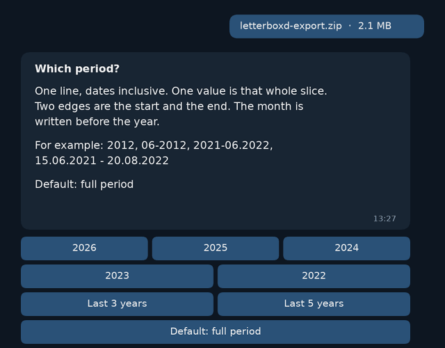
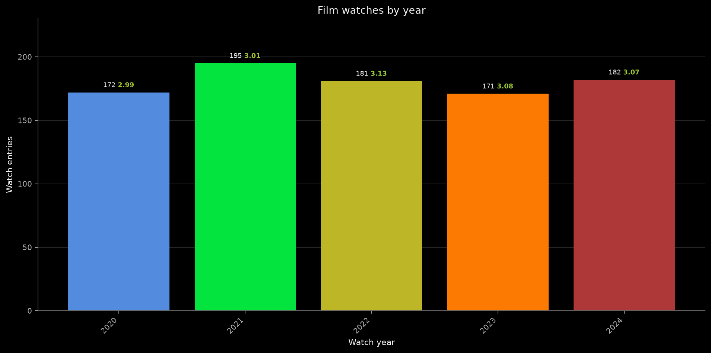
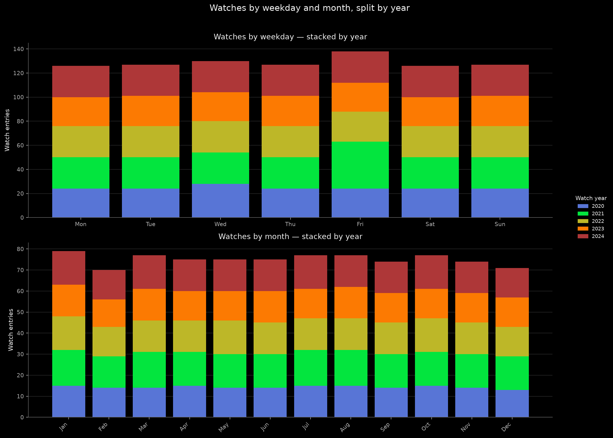
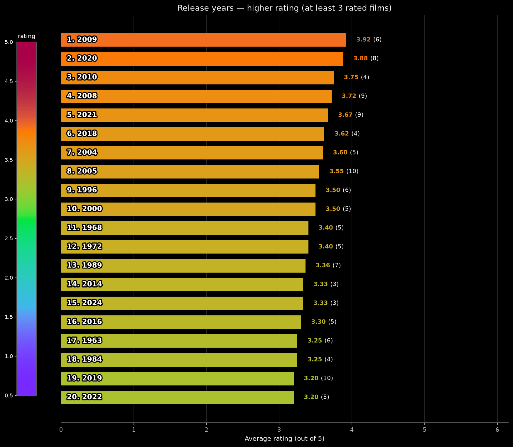
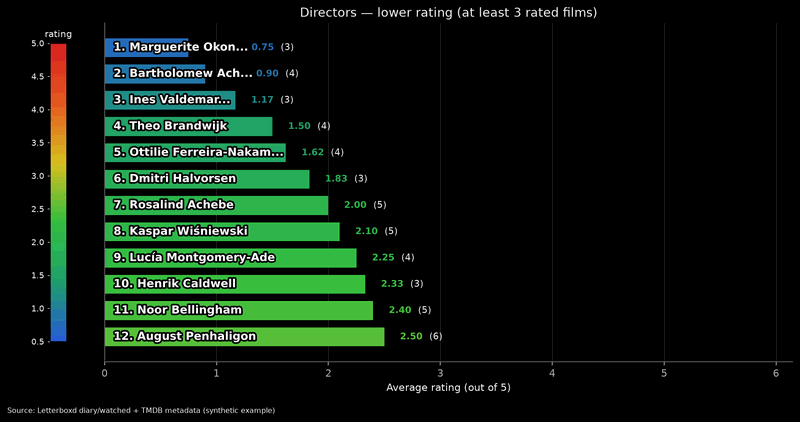

# LetterboxdStats

[@lebxdbot](https://t.me/lebxdbot) turns a Letterboxd export ZIP into a dark-theme chart report in the chat. `/start` begins. `/stop` cancels.

Webhook: `POST https://t2t-box.prtndz.workers.dev/lebxd` on the Cloudflare worker `t2t-box`.

## What it produces

You send the ZIP from Letterboxd → Settings → Import & Export → Export Your Data. The bot asks a few questions, then posts a short summary and a series of PNG charts in the same chat. The images below come from synthetic data, not a real export.



*The wizard asks one question at a time. Tap a button or type a reply.*



*Watches per year, with the count and the bold colored average rating above each bar.*



*When you watch: weekdays and months, stacked by watch year.*



*Release years with the highest average rating, among years with at least 3 rated films.*



*Directors with the lowest average rating. A bar too short for 15 letters shows the first 15 and an ellipsis.*

## Commands

| Command | What it does |
| --- | --- |
| `/start` | Asks for the Letterboxd export ZIP, then builds the charts. Default uses the usual set. Customize sets the top size (1–100), the minimum number of rated films, whether USA and English stay in those tops, the watch period, and films with no diary date. |
| `/start letterboxd` | The same wizard. This is what `https://t.me/lebxdbot?start=letterboxd` opens. |
| `/stop` | Clears the wizard. If a chart run is already in GitHub Actions, it stops that run. |

Dates are month before year. `2021-06.2022` means 2021-01-01 through 2022-06-30. A year is that whole year. A month is `06-2012` or `June 2012`. A day is `15-06-2012` or `15.06.2012`.

## Charts

The report is a set of PNG charts in the chat: calendar (watches, pace, weekdays), extra stats, and TMDB tops for genres, countries of origin, directors, actors, original language, and studios. A rating bar ends with a bold colored average and a regular parenthetical count. A name stays inside its bar and is shortened with an ellipsis only when it does not fit. A bar too short for 15 characters shows the first 15 characters and an ellipsis, running past the end of the bar.

Example title: Studios — lower rating (at least 3 rated films).

## Bot profile

After this is on `main`, run the **Setup bot** workflow once. It writes the English BotFather short description, description, and the `/start` and `/stop` command menu. It does not set the webhook. **Set webhook** registers `https://t2t-box.prtndz.workers.dev/lebxd` and the same English command menu.

Short description and description:

> A Letterboxd ZIP becomes a dark-theme chart report in this chat. /start begins, /stop cancels.

Commands: start — Start a Letterboxd chart report. stop — Cancel the wizard or a running report.

## Configuration

GitHub Actions secrets on this repository:

| Secret | Used by |
| --- | --- |
| `LEBXDBOT_TOKEN` | Chart workflow `letterboxd.yml` (download the ZIP and send the PNGs) |
| `WEBHOOK_SECRET` | **Set webhook** |
| `TMDB_BEARER_TOKEN` | Chart workflow (TMDB Read Access Token, not an API key) |
| `CLOUDFLARE_API_TOKEN` | **Deploy worker** |
| `CLOUDFLARE_ACCOUNT_ID` | **Deploy worker** |

Cloudflare worker `t2t-box` secrets used by this bot:

| Secret | Role |
| --- | --- |
| `LEBXDBOT_TOKEN` | Telegram bot token |
| `WEBHOOK_SECRET` | Check on `POST /lebxd` |
| `GHLEBXD_DISPATCH_TOKEN` | Starts and cancels `letterboxd.yml` |

Do not put secret values in git.

## Develop

Checks without Cloudflare and without tokens, Node 22:

```bash
cd worker
npm ci
npm test
```

## Workflows

Manual workflows, after merge to `main`:

1. **Deploy worker** — publishes worker `t2t-box`. Needs `CLOUDFLARE_API_TOKEN` and `CLOUDFLARE_ACCOUNT_ID`.
2. **Set webhook** — points @lebxdbot at `https://t2t-box.prtndz.workers.dev/lebxd`.
3. **Setup bot** — English BotFather profile and command menu. Run this after merge. It does not register the webhook.
4. **Letterboxd** — the chart job. The worker starts it.

Layout:

- `worker/` — webhook and wizard, then `workflow_dispatch` of `letterboxd.yml`.
- `vm/letterboxd_genres.js` — wizard steps and date parsing.
- `scripts/` — calendar charts and TMDB charts. The job sends PNGs with `LEBXDBOT_TOKEN`.
