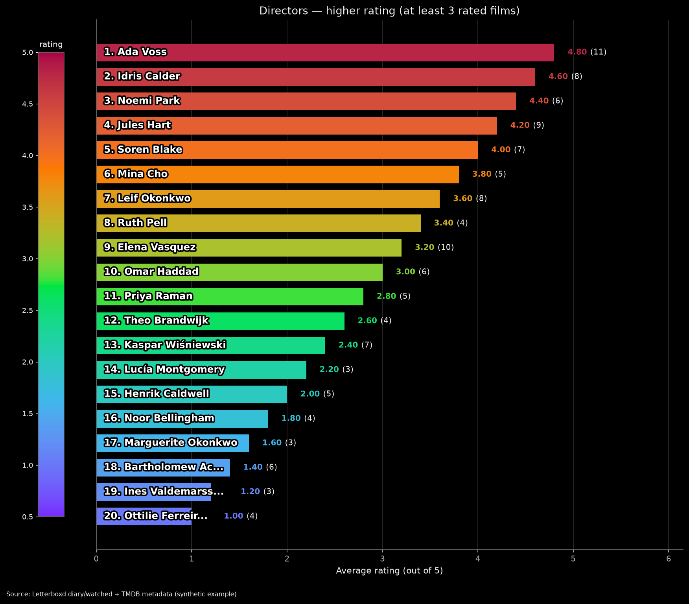
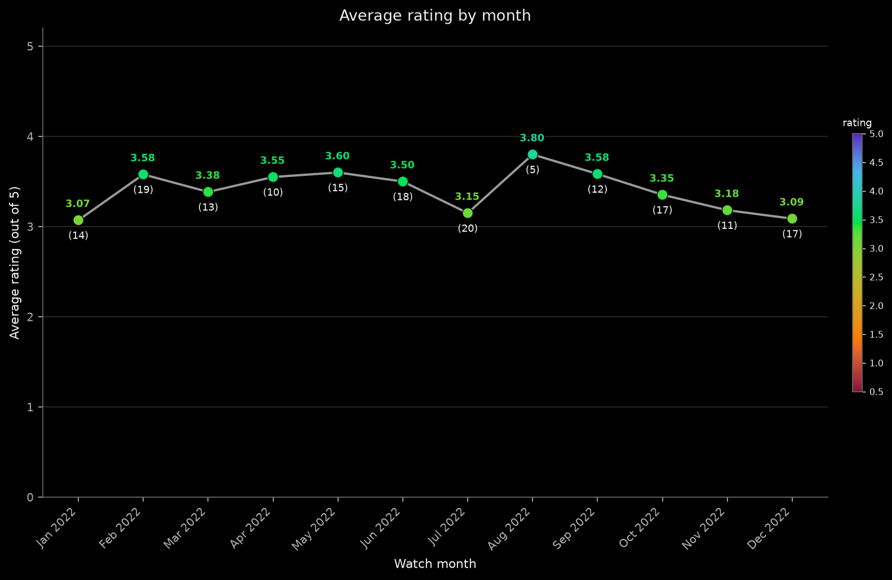
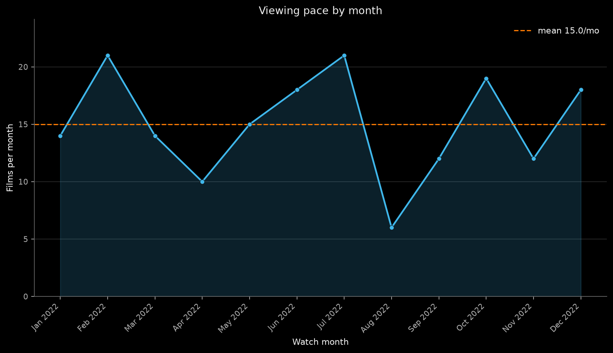
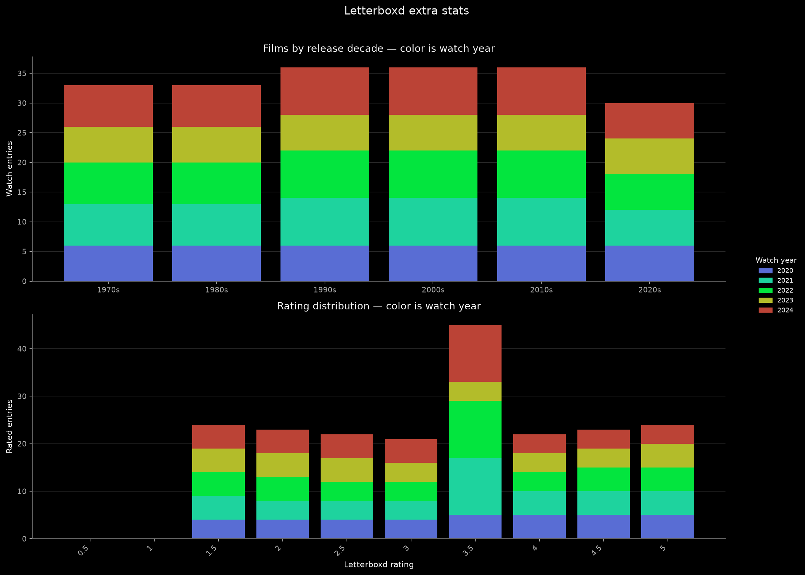
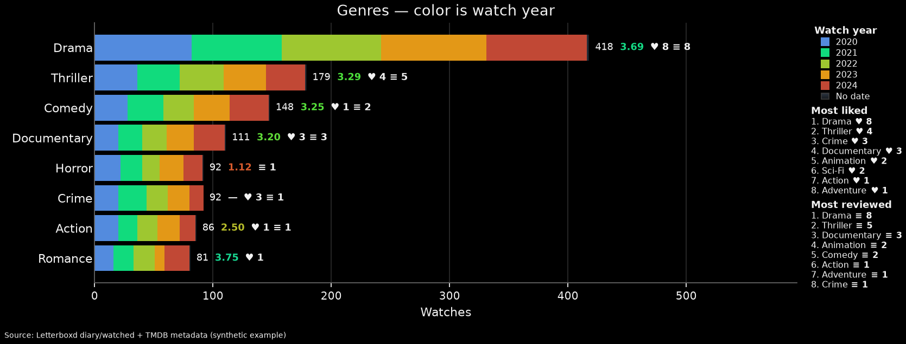
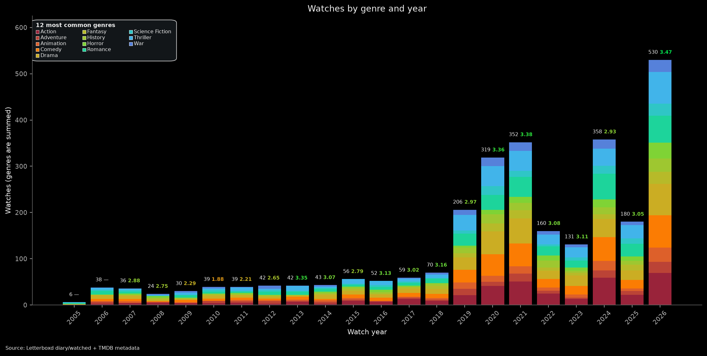
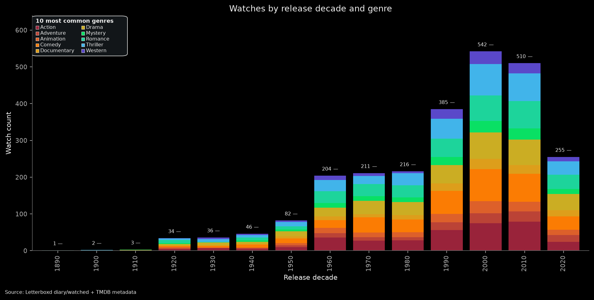
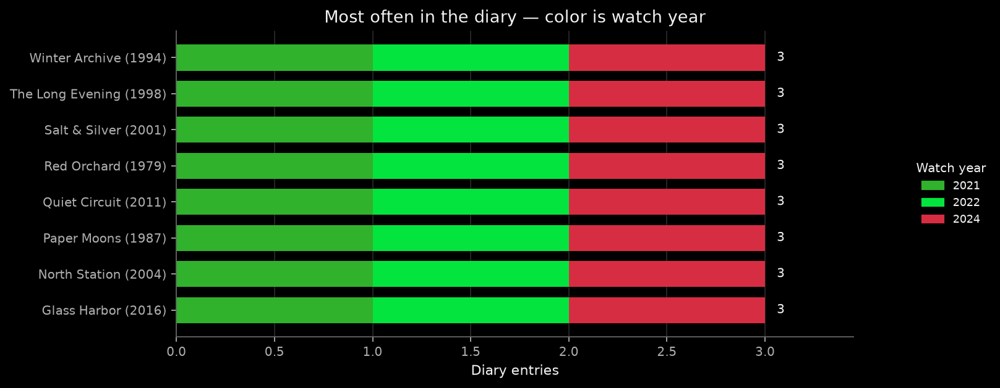

# LetterboxdStats

[@lebxdbot](https://t.me/lebxdbot) turns a Letterboxd export ZIP into a dark-theme chart report in the chat. `/start` begins. `/stop` cancels.

Webhook: `POST https://t2t-box.prtndz.workers.dev/lebxd` on the Cloudflare worker `t2t-box`.

## What it produces

You send the ZIP from Letterboxd → Settings → Import & Export → Export Your Data. The bot asks a few questions, then posts a short summary and a series of PNG charts in the same chat. The images below come from synthetic data, not a real export.


*The wizard asks one question at a time. Tap a button or type a reply.*


*Watches per year. Above each bar: bold `♥ N ≡ M` when likes fall among that year’s watches or reviews were logged in that year (`reviews.csv` Date), then the white count and the bold colored average. When any year has reviews, an in-plot **Most reviewed years** panel ranks those years by the same tip counts (top-left at the tallest-bar shelf, raised only to clear bars/tips; five rows per column, wrapping right; a short final remainder of 1–3 rebalances the last two columns, e.g. 11 → 5|3|3). Five years use the even palette midpoints (not the three logo knots alone).*


*When you watch: weekdays and months, stacked by watch year. Tips are the same count + average pair, with bold `♥ N` / `≡ M` on a line above (`≡` buckets use review Date). The right column is Watch year, then **Most liked weekdays** / **Most liked months**, then **Most reviewed** for each.*


*Release years with the highest average rating, among years with at least 4 rated films. Bar color follows the rating scale on the left. Short year names keep `♥ N` / `≡ M` with the rank label; the tip is the bold colored mean and `(n)` unique rated films, past any overflowing label.*


*Directors with the lowest average rating (at least 4 rated films). A bar too short for 15 name letters shows the first 15 and an ellipsis, then bold `♥ N` / `≡ M`, overflowing right so the tip stays clear. Longer bars keep the label inside and ellipsize the name earlier so the metrics still fit.*



*A top 20 across the rating scale (at least 4 rated films): one smooth blend from purple at 4.80, through logo blue, green, and orange, to burgundy at 1.00. Short bars overflow fifteen letters; bold `♥ N` / `≡ M` sit in the label when present.*



*Average rating over the watch months: a line, a dot colored on the rating scale, the mean above the marker, and `(n)` rated diary rows below it.*



*Viewing pace by month. The dashed line is the mean. Pace charts stay unlabeled (no count/avg tip).*



*Release decade (catalog hits) and rating distribution (dated diary ratings plus undated rated catalog under **No date**). Watch years color the stacks; **No date** is the logo charcoal gradient (top→bottom on these columns). Decade tips show `♥` / `≡`, count, and average; rating tips are bold `NN.NN%` plus `(count)`. **Most liked** and **Most reviewed** sit under the Watch year legend.*



*Watches by genre (catalog hits), stacked by watch year, with undated rows in the **No date** charcoal segment (left→right on horizontal bars). Tips are count + average + inline `♥ N` / `≡ M`. The side panel lists **Most liked** and **Most reviewed** under Watch year.*



*Watches by genre and year. Segments stack bottom→top in red→violet genre colors from one run-wide map (same genre → same hex on the decade chart too). The in-plot legend sits top-left at the tallest-stack shelf (raised only to clear tips), five rows per column with last-two rebalance.*



*Watches by release decade and genre. Genre colors match the genre×year chart; stack and legend order follow the same red→violet spectrum among the genres shown.*



*Films logged more than once, stacked by watch year. Titles append `♥` / `≡` when liked or reviewed. The tip is count + average (mean of every rated diary row for that film, rewatches included). The side panel keeps **Watch year**; **Most reviewed** (bold `≡` + count) lists library-wide films with more than one review row and is omitted when none qualify. There is no Most liked list on this chart.*

## Commands

| Command | What it does |
| --- | --- |
| `/start` | Asks for the Letterboxd export ZIP, then builds the charts. Default uses the usual set. Customize sets the top size (1–100), Scale (5 / 10 / 100, default 5), the rating-count threshold for average-rating tops, whether rewatches count in averages, whether to show likes (♥) and reviews (≡), optional Top review (default on), optional exclusions from watch-count tops (USA, English, Drama, Comedy, custom exclude keywords), optional search keywords (film lists after charts), the watch period, and films with no diary date. Paste settings reuses a previous `Tops: Scale: … Period:` summary from an earlier run. Wizard steps edit one bot message in place. |
| `/start letterboxd` | The same wizard. This is what `https://t.me/lebxdbot?start=letterboxd` opens. |
| `/stop` | Clears the wizard. If a chart run is already in GitHub Actions, it stops that run. |

Dates are month before year. `2021-06.2022` means 2021-01-01 through 2022-06-30. A year is that whole year. A month is `06-2012` or `June 2012`. A day is `15-06-2012` or `15.06.2012`.

## Customize averages and which rows appear

After the ZIP, the mode step offers **Default**, **Customize**, and **Paste settings**. Paste settings asks for a previous settings paragraph (the line that starts with `Tops:` and ends with `Period:`; when the period is a date range it may also include `No diary date:`). Extra text around that paragraph is fine. A bad paste stays on that step and asks again. The bot’s own summary puts count-top filters and keywords under `Exclude:` (e.g. `Exclude: USA, Drama, "Wood".` when those are filtered out; `Exclude: none.` when nothing is), uses short `Search:` for film-list keywords, and ends with a one-line note that you can paste the summary into Paste settings later. Older summaries with separate `USA: yes/no` fields still parse.

On **Customize**, after top size comes **Scale** (5 / 10 / 100, default **5**): tip and axis numbers use `value × (scale/5)` on full-precision 0.5–5 means, then round (scale ≥ 100 → integer; > 10 → 1dp; < 5 → 3dp; else 2dp). Colors, ranking, and thresholds stay on the internal scale. Top review ★/½ stay 5-point. Settings summary: `Scale: 5|10|100.` right after `Tops:` (no `10-point ratings:` line). Paste accepts `Scale:`; older `10-point ratings: yes/no` maps yes→10, no→5; when both appear, Scale wins. Invalid Scale stays on the paste step with an error.

After Scale and the rating-count threshold, the wizard asks whether **previous / rewatch diary views** should count in average ratings.

| Choice | What happens |
| --- | --- |
| **No** (default) | One rating per unique film (Name+Year): latest diary rating, else `ratings.csv`. Rewatches do not inflate averages; they clutter the statistics. |
| **Yes** | Each **rated diary row** contributes to qualitative means (including rewatches). Same spirit as the tip mean on **Most often in the diary**, applied to Average rating by …, higher/lower rating tops, colored averages on count bars, decade/year averages, and the diary summary mean. |

The rating-count **threshold** still needs that many **unique rated films** (Name+Year), not rated diary rows. On count / watch bars whose category is **not** a watch date (release decade or year, genre, director, actor, studio, country, language), bar **lengths** are **catalog hits**: every diary row plus one for each watched-only film in the period-scoped catalog. Undated catalog rows stack under **No date**. The extra-stats rating distribution includes undated rated catalog entries under **No date** as well. Charts that need a watch date (watch year, weekday, month, viewing pace, most often in the diary / rewatches) stay diary-dated only. Only how the **mean** is computed changes when Yes.

**Most often in the diary** always uses all rated diary rows for its tip mean — this setting does not change that. **Search-keyword** film lists always list every view’s rating slot; the toggle does not change those lists. Watch-time average charts that already mean over each rated diary row in its watch bucket stay as they are.

Next, two yes/no questions: **Show likes (♥)?** and **Show reviews (≡)?** Both default to **yes** (same as Default mode and when unset). **No** on likes omits ♥ everywhere — tips, titles, Most liked panels, Top review panel titles, search hearts, and inside-bar ♥. **No** on reviews omits ≡ everywhere — tips, Most reviewed, search ≡, and inside-bar ≡ — and skips **Show top review?** (forces Top review off). The settings summary records `Likes: yes/no.` and, when Top review is off, `Reviews: yes/no.`; Paste settings accepts those fields (older summaries without them keep both on).

When reviews are on, **Show top review?** (default **yes**; Customize can disable). **Yes** draws an in-plot panel on listed ranking charts (Most often in the diary; release years / genres / countries / directors / actors / languages / studios — watches and higher/lower rating). Corner: bottom-right on watches/count / higher-rating; top-right on lower-rating. The panel walks the drawn top for the highest-ranked row that has a review, then picks among that row’s reviews: highest review/film rating on watches/count tops (and Most often) and on higher-rating charts; lowest on lower-rating charts; when every candidate is unrated, liked films first; then latest review Date (then Name/Year). Text is truncated to 280 characters; the panel shows film title (year), ♥ when that film is liked, pick rating as ★/½ on the next line when rated (omitted when unrated), and review date. If Exclude removes the true top on a count chart, the panel is omitted. **Yes** also lifts the full-slate gate so lower-rating charts still emit. Settings summary: when Top review is on, only `Top review: yes.` (implies reviews on); when off, only `Reviews: yes/no.` — never both lines. Paste: `Top review: yes` turns both on; `Reviews: no` turns both off; legacy dual lines still parse. Missing Top review in older summaries → on (same as Default).

Next, the wizard asks whether to remove some rows from the **watch-count** tops.

| Choice | What happens |
| --- | --- |
| **No** (default) | Keep every row. Same as including USA, English, Drama, and Comedy, and adding no exclude keywords. Then ask about search keywords. |
| **Yes** | Ask the toggles below, then optional exclude keywords, then search keywords, then the watch period. |

Built-in toggles (only on the **Yes** branch):

- **USA** — drop the United States from the country watch top
- **English** — drop English from the language watch top
- **Drama** / **Comedy** — drop those genres from the genre watch charts

**Exclude keywords** come next on the Yes branch. Send one word or phrase per message (actor, director, studio, genre, language, country, or **release year** such as `2001`). Matching is case-insensitive against the **row name on the chart**. Tap **Done** when finished. They do **not** change the watch-year axis or the date-range step.

These exclusions apply only to **count / watches** tops (genres, countries, directors, actors, languages, studios, release years by watches, rewatches, and the stacked genre charts). **Average-rating** tops (higher / lower) stay unchanged.

**Search keywords** are a separate optional step after exclusions (or after answering No to remove rows). They do not hide chart rows. If you add any, then **after every chart PNG** the bot sends a text list per search keyword: every catalog film (same period / undated rules as the charts) where that keyword is a case-insensitive substring of film metadata — genre, director, top-5 billed actor, studio, country, language, or **release year**. The list is split into sections headed by match site (that fixed order); under each header films are numbered `1.`, `2.`, … and a film that matches several fields appears under each. Line shape: `1. Name (Year): 5, —, 3.5` (colon before ratings; `—` only for empty watch slots); a `♥` (U+2665) after the year marks films liked in `likes/films.csv`, and a `≡` (U+2261) marks films with a row in top-level `reviews.csv`. Diary watches are oldest→newest by Watched Date; a diary row without Rating falls back to `ratings.csv` for that title, else `—`. A film with no diary rows (watched-only / ratings-only) gets one slot: `ratings.csv` or `—`. Empty sections are omitted. Skip or add none → no lists. Cap is the same as exclude keywords (20 words, 40 characters each).

Bar and column charts label each bar with the **count** and the **average rating** (a dash when the average is below the threshold or missing). Exceptions: the Letterboxd rating distribution in extra stats shows each bucket’s **percent of all ratings on that chart** (bold, two decimal places) plus the absolute count in parentheses (`NN.NN% (count)`; the rating is already the x-axis); Viewing pace and other non-bar pace charts stay unlabeled. Scatter/dot **Average rating by …** charts put the mean above the marker and the rated-film count in parentheses below it. **Most often in the diary** keeps diary-row counts, and its average tip is always the mean over all rated diary watches of that film (including rewatches), independent of the customize toggle.

**Liked hearts** (`♥`, U+2665 only — never emoji) come from film-level `likes/films.csv` (Name+Year), scoped like the charts. Film-title bars (for example **Most often in the diary**) append `♥` after the visible title, including after a `...` truncation. Average-rating category bars (genres, directors, actors, …) show `♥ N` beside the name when that row’s average set includes N > 0 liked films. Quantitative count tips add `♥ N` only when N > 0: **inline** after count + average on horizontal bars; on a **separate** tip line above the pair on vertical columns. Charts that already show a **Watch year** legend also get a **Most liked** side list under it: top N positions by liked-film count (`1. Name ♥ 12` with bold mark and count); omitted entirely when nothing is liked. The list is a compact text block with tight line spacing (not stretched to bar height). The combined weekday + month figure uses two lists instead of one mixed ranking: **Most liked weekdays** (every weekday with likes, up to all seven) and **Most liked months** (capped by the customize top size). A list with no likes is omitted.

**Review marks** use bold `≡` (U+2261 IDENTICAL TO — never emoji; no VS15), same weight emphasis as bold `♥ N` on average labels. Source is top-level `reviews.csv` (unique Name+Year for presence; not `likes/reviews.csv`). Layout matches likes: bare `≡` after film titles (including after truncation), bold `≡ M` on average-rating category labels when M > 0, bold inline after count+avg on horizontal tips, and on a separate tip line on vertical columns (combined as `♥ N ≡ M` when both apply). Charts with a Watch year legend also get **Most reviewed** directly under **Most liked** (same top-N / weekday+month split rules, compact line spacing; bold `≡` + bold count), except **Most often in the diary**, which has no Most liked list and ranks **Most reviewed** library-wide by review-row count (only films with more than one review). **Film watches by year** adds an in-plot **Most reviewed years** panel (same date-bound tip counts; top-left at the tallest-bar shelf and raised only on overlap; five rows per column wrapping right, with a short final remainder of 1–3 rebalanced across the last two columns; omitted when no year has reviews). Genre×year and decade×genre stacks share one run-wide red→violet genre color map (same name → same hex); stack and legend order follow that spectrum among the genres shown. Watch-date chart tips / Most reviewed buckets use each review’s own `Date`. Search-keyword HTML bolds the mark. DejaVu Sans has the glyph (same face as ♥).

## Charts

The report is a set of PNG charts in the chat: calendar (watches, pace, weekdays), extra stats, and TMDB tops for genres, countries of origin, directors, actors, original language, and studios. On a bar chart the tip shows the count and a bold colored average (or a dash); on a rating bar the tip also keeps the rated-film count in parentheses. On an Average rating by … scatter chart the mean sits above the marker and `(n)` below it. The Letterboxd rating distribution tip is bold `NN.NN%` plus `(count)` for that bucket’s share of all ratings on that chart (not the star rating). A name stays inside its bar and is shortened with an ellipsis only when it does not fit. A bar too short for 15 characters shows the first 15 characters and an ellipsis, running past the end of the bar.

Every chart uses one palette. The anchors are the three logo circles, measured from the non-overlapping interior of each circle: blue `#3FB7EB` at 0.15, green `#03E53E` at 0.35, and orange `#FC7A02` at 0.8. The blend is a straight line in OKLab between five knots: deep purple `#5922BF` at 0, those three logo colors, and deep burgundy `#890E3A` at 1. The uneven spacing keeps the scale from looking uniform. A rating uses the whole range in reverse: 5 maps to 0 (deep purple) and 0.5 maps to 1 (deep burgundy). An ordered series (watch years, ranked genres), earliest or lowest first, is logo green for one value, logo blue and orange for two, and the three logo colors for three. Four or more values use the even bin midpoints `(i + 0.5) / N`, across the whole palette, with no bend toward the logo colors. Four values are 0.125, 0.375, 0.625, and 0.875. Seven values are 0.5/7, 1.5/7, 2.5/7, 3.5/7, 4.5/7, 5.5/7, and 6.5/7. On watch-year stacks, **No date** (undated catalog rows) uses the Letterboxd logo-background charcoal gradient (`#2C3440` → `#14181C`) — not a position on that purple→burgundy year scale and not solid white. Vertical columns keep the logo top→bottom axis; horizontal bars rotate it 90° to left→right. Legend swatches use the logo-native vertical gradient with a thin border on the dark chart surface. In-plot panels (Top review, Most reviewed years, genre legends) fill with the same logo-background charcoal gradient as **No date** (`#2C3440` → `#14181C`, top→bottom).

Example title: Studios — lower rating (at least 4 rated films).

## Bot profile

An empty chat shows the description below, with Telegram's own Start button under it. That button is part of the Telegram app. A tap sends `/start`, which opens the wizard.

**Setup bot** writes the description, the short description, and the `/start` and `/stop` menu. The display name stays whatever BotFather already has. Run **Setup bot** once after this is on `main`. It does not publish the worker and it does not register the webhook.

Description (what Telegram shows on an unused/empty chat, and “What can this bot do?”):

> Letterboxd Stats (@lebxdbot) builds charts from a Letterboxd export ZIP.
>
> /start, then the ZIP. Default, Customize, or paste settings. Customize edits one message: tops 1–100, scale 5/10/100, threshold, rewatches in averages, likes (♥), reviews (≡), Top review, Exclude on count tops, Search keywords, watch period. /stop leaves the questions. A started chart run stops too.
>
> Author:
> https://www.last.fm/user/pretendless
> https://vk.com/prtds
> https://t.me/prtdz

Short description (profile page / shared-link blurb only, ≤120 chars — not the empty-chat card; one Telegram contact here, full https URLs in the long description):

> Letterboxd Stats. Charts from a Letterboxd export ZIP. /start opens the wizard. Contact: @prtdz

Commands: start — Start a Letterboxd chart report. stop — Cancel the wizard or a running report.

If the live chat still answers in Russian, also run **Deploy worker**. Those replies are already English on `main` and reach Telegram only after that deploy. **Set webhook** registers `https://t2t-box.prtndz.workers.dev/lebxd` and refreshes the same command menu.

## Configuration

GitHub Actions secrets on this repository:

| Secret | Used by |
| --- | --- |
| `LEBXDBOT_TOKEN` | Chart workflow `letterboxd.yml` (download the ZIP and send the PNGs) |
| `WEBHOOK_SECRET` | **Set webhook** |
| `TMDB_BEARER_TOKEN` | Chart workflow (TMDB Read Access Token, not an API key) |
| `CLOUDFLARE_API_TOKEN` | **Deploy worker** |
| `CLOUDFLARE_ACCOUNT_ID` | **Deploy worker** |

Cloudflare worker `t2t-box` secrets used by this bot:

| Secret | Role |
| --- | --- |
| `LEBXDBOT_TOKEN` | Telegram bot token |
| `WEBHOOK_SECRET` | Check on `POST /lebxd` |
| `GHLEBXD_DISPATCH_TOKEN` | Starts and cancels `letterboxd.yml` |

Do not put secret values in git.

## Develop

Checks without Cloudflare and without tokens, Node 22:

```bash
cd worker
npm ci
npm test
```

## Workflows

Manual workflows, after merge to `main`:

1. **Deploy worker** — publishes worker `t2t-box`. Needs `CLOUDFLARE_API_TOKEN` and `CLOUDFLARE_ACCOUNT_ID`.
2. **Set webhook** — points @lebxdbot at `https://t2t-box.prtndz.workers.dev/lebxd`.
3. **Setup bot** — English BotFather profile and command menu. Run this after merge. It does not register the webhook.
4. **Letterboxd** — the chart job. The worker starts it.

Layout:

- `worker/` — webhook and wizard, then `workflow_dispatch` of `letterboxd.yml`.
- `vm/letterboxd_genres.js` — wizard steps and date parsing.
- `scripts/` — calendar charts and TMDB charts. The job sends PNGs with `LEBXDBOT_TOKEN`.
